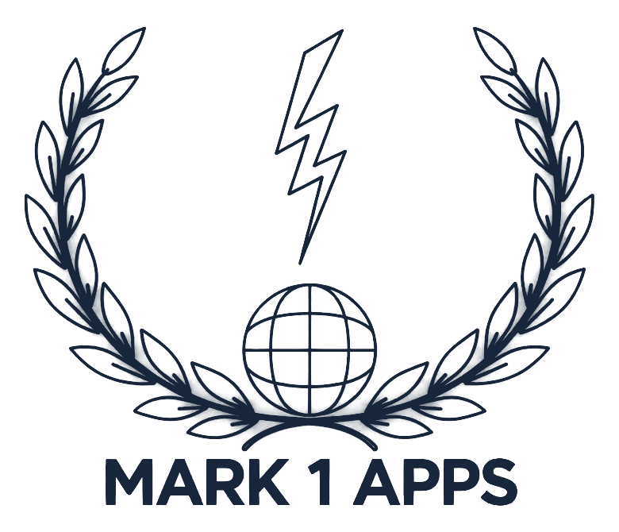

# Mark 1 Apps brand rules

Agreed by Mark Brown and Shelley Brown, 3 November 2026. The visual board is the "Mark 1 Apps brand board" canvas; this file is the written record, and every company document follows it.

## Who we are

Mark 1 Apps Ltd is the company; My Medical Daybook is what it makes. The company uses Daybook's colours, so a letter, the website and the app look like one family. Mark 1 Apps speaks on letters, contracts, invoices and to partners; Daybook speaks to patients and carers.

## The logo

| Version | Use it on | Never |
| --- | --- | --- |
| Navy line mark | Letters, documents, slides, the website footer: anything light | Stretched, recoloured, tilted, or on a busy picture |
| Neon glow mark | The opener video and dark screens only | On white or light paper, or inverted |

- **Clear space:** at least the height of the words MARK 1 APPS all round.
- **Smallest size:** 15 mm wide in print, 60 px on screen.
- **Beside the name:** the mark to the left of "Mark 1 Apps Ltd", with "Makers of My Medical Daybook" under it in teal.

## Colours

| Colour | Hex | Use it for |
| --- | --- | --- |
| Navy | #17263A | The logo, the company name, headings, footer text |
| Teal | #18727A | One accent: "Makers of My Medical Daybook", links |
| Slate | #4B5B6B | Small print: dates, contact details, job titles |
| Body ink | #1C2430 | Letter text |
| Cream | #F6F4EF | Daybook's paper on screen (white on paper) |
| Terracotta | #C2703D | A rare warm highlight, never text |

- **One accent per page:** teal or terracotta, not both.
- **Retired:** the old bright blue, #0A4FA8.

## Fonts

| Font | Job |
| --- | --- |
| Montserrat Bold | The company name, built into pictures so it never changes |
| Fraunces | Daybook's name and headings |
| Inter | Daybook's everyday text |
| Arial | Anything typed in Word, Pages or slides |

Letters: 11 pt text, 8 pt footer, nothing smaller. Bold for a name or one key phrase only.

## The watercolour

Our own painting from Daybook's opening screen: misty trees at dawn through a window. A faint sky at the top of a page, the trees and the dawn glow at the foot, fading into white. Never behind the logo at full strength or behind body text; text on it is navy and stays easy to read. No stock watercolours.

## How we sound

**Calm. Honest. Human.** Plain words, short sentences, UK English, no em dashes. Facts, never medical advice.

| We say | We don't say |
| --- | --- |
| Your records stay in your care circle. | Your data is protected by cutting-edge security. |
| Write down what happened, when it happened. | Optimise your health outcomes with smart tracking. |
| Not medical advice. If you are worried, call 111. | Daybook tells you when something is wrong. |

## Names

| Write | When |
| --- | --- |
| Mark 1 Apps Ltd | The first time, and on anything legal |
| Mark 1 Apps | After that. Never Mark1, M1A or Mark One |
| My Medical Daybook | Covers, reports, the website, formal letters: My Medical small over Daybook large |
| Daybook | Inside the app and in everyday talk |
| Care circle | The patient and the people they choose. Never household, account or group |
| Daybook Assistant | The AI helper. Never Daybook's own AI |

## Photographs

| Use | Avoid |
| --- | --- |
| Real photographs, natural light, everyday homes | Pictures that look made by AI |
| People in their forties who look like Mark and Shelley | Hospital beds, drips and scans |
| Faces from behind or the side when a picture is made | Anyone's face without their agreement |
| Soft colour that sits with the watercolour | Stock smiles and thumbs up |

## Easy to read

- **11 pt** the smallest text on paper; 17 px on a screen.
- **4.5 to 1** contrast at least between text and what is behind it.
- **Never colour alone** to tell things apart; say it in words as well.

## Company details

Every letter, email signature and invoice carries: Mark 1 Apps Ltd. Registered in England and Wales, company number 17510025. Registered office: 71-75 Shelton Street, London WC2H 9JQ. ICO registration ZC275185. Website: mymedicaldaybook.co.uk. Email: mark@mark1apps.co.uk. (The phone number is in the brand rules doc, kept out of this public repository.)

## Templates and files

- **Letters and company documents:** `tools/letterhead/make_doc.cjs` (Markdown in, Word out) and the letter template.
- **Pictures in this folder:** the navy mark (`logo-navy.png`, and `logo-navy-transparent.png` for coloured backgrounds), the lockup with the name (`lockup.png`), the letterhead's sky header and watercolour foot.
- **Still to make:** the PowerPoint (and Keynote) template, the email signature.
